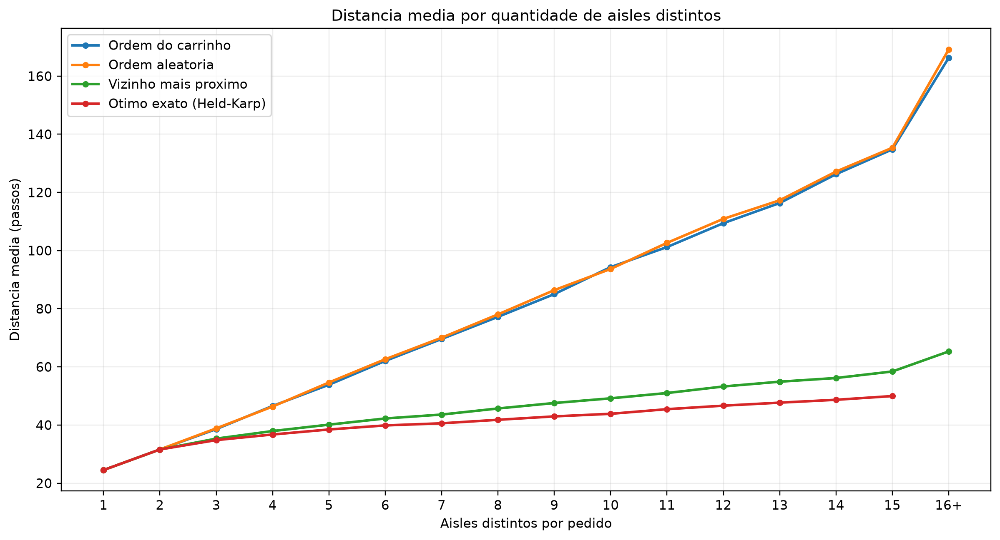
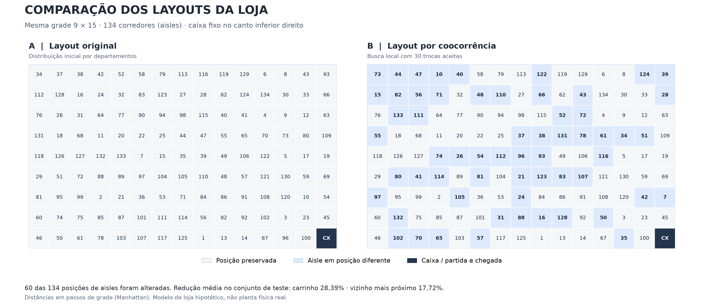
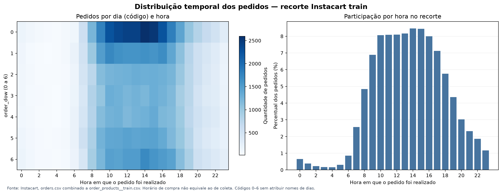

# Coleta Eficiente de Pedidos de Supermercado Online

Projeto da disciplina **SMAC03 – Grafos** (UNIFEI, 2º semestre de 2026), referente ao Cenário 5.

O projeto investiga rotas para a coleta de pedidos de supermercado online. Como o dataset *Instacart Market Basket Analysis* não informa uma planta física da loja nem a localização exata dos produtos, o grupo utiliza um layout hipotético modelado por meio de **grafos** e compara diferentes estratégias de visita aos pontos de coleta.

---

## Integrantes

| Integrante | Papel |
|---|---|
| *Matheus Dourado* | Coordenador |
| *Renan Morais* | Modelador A |
| *Lucas Melo* | Modelador B |
| *Caio Lene* | Desenvolvedor A |
| *João Pedro Sabino* | Desenvolvedor B |

---

## As duas modelagens

### Modelo 1 — Grafo da Loja

O supermercado é representado por um grafo simples, não direcionado e não ponderado, organizado em uma grade ortogonal de 9 × 15 posições, com 134 pontos de coleta e um caixa.

As distâncias são calculadas pela métrica de Manhattan. Para cada pedido, são identificados os aisles obrigatórios e comparadas quatro estratégias de roteamento: ordem do carrinho, ordem aleatória, vizinho mais próximo e ótimo exato por Held-Karp.

### Modelo 2 — Grafo de Coocorrência

O segundo modelo utiliza um grafo não direcionado e ponderado para representar associações entre aisles, com pesos definidos pela similaridade de Jaccard.

A partir dessas relações, uma busca local reorganiza a distribuição das categorias na loja, mantendo a grade e a posição do caixa. A eficiência do layout é avaliada comparando as distâncias das rotas antes e depois da otimização.

---

## Experimentos e resultados

Os experimentos foram realizados com pedidos do dataset Instacart, utilizando o layout hipotético da loja. As distâncias são expressas em passos na grade 9 × 15.

### Experimento 1 — Comparação das estratégias de roteamento

Foram avaliados os primeiros 10.000 pedidos do conjunto train, considerando os identificadores em ordem crescente e comparando quatro estratégias de roteamento. Para a estratégia aleatória, foram realizados cinco sorteios por pedido. O algoritmo exato de Held-Karp foi aplicado somente aos pedidos com até 15 aisles distintos.

| Estratégia | Distância média (passos) | Pedidos avaliados |
|---|---:|---:|
| Ordem do carrinho | 74,37 | 10.000 |
| Ordem aleatória | 75,05 | 10.000 |
| Vizinho mais próximo | 43,82 | 10.000 |
| Ótimo exato (Held-Karp) | 39,10 | 9.222 |

O vizinho mais próximo apresentou redução média de 41,08% na distância percorrida em comparação à ordem do carrinho. Nos pedidos com solução exata, igualou o resultado ótimo em aproximadamente 49,83% dos casos.

A média do Held-Karp considera somente os 9.222 pedidos elegíveis, não devendo ser comparada diretamente às médias dos 10.000 pedidos.



Os resultados completos estão disponíveis em `results/experimento_modelo1_amostra_por_pedido.csv` e `results/experimento_modelo1_amostra_resumo.json`.

### Experimento 2 — Comparação dos layouts

O segundo experimento utilizou 131.209 pedidos do conjunto `train`, divididos em 104.967 pedidos de treinamento (80%) e 26.242 de teste (20%), com semente 2026.

O grafo de coocorrência foi construído utilizando somente os pedidos de treinamento. A otimização reorganizou os aisles por meio de trocas de posição, buscando reduzir as distâncias entre categorias frequentemente compradas juntas.

A função objetivo do layout apresentou redução de 21,61% após 30 trocas. A avaliação das rotas foi realizada separadamente, utilizando os mesmos pedidos de teste nos dois layouts.

| Estratégia | Layout original (passos) | Layout otimizado (passos) | Redução |
|---|---:|---:|---:|
| Ordem do carrinho | 74,39 | 53,27 | 28,39% |
| Vizinho mais próximo | 43,86 | 36,09 | 17,72% |

O layout otimizado apresentou menores distâncias médias nas duas estratégias avaliadas, embora nem todos os pedidos tenham apresentado melhoria individual.



Os resultados estão disponíveis em `results/comparacao_layouts.json`. O grafo ponderado e o layout otimizado estão armazenados em `data/processed/`.

### Análise temporal e estimativas operacionais

Também foram analisados os padrões temporais dos 131.209 pedidos, considerando os dias e horários registrados no dataset.

O recorte apresentou médias de 10,55 itens e 7,55 aisles distintos por pedido. O horário com maior volume de compras foi 14h, com 11.103 pedidos.



Com base nas distâncias obtidas no experimento de comparação dos layouts, foram calculadas estimativas de tempo de coleta e capacidade por turno.

As estimativas consideram 1,5 metro por passo, velocidade de 1,2 m/s, 20 segundos por item, 120 segundos fixos por pedido e sete horas efetivas de trabalho por turno para um funcionário.

| Estratégia | Layout original | Layout otimizado |
|---|---|---|
| Ordem do carrinho | 59 pedidos/turno | 63 pedidos/turno |
| Vizinho mais próximo | 65 pedidos/turno | 67 pedidos/turno |

Os horários registrados correspondem à realização das compras, não necessariamente à coleta física. Os tempos e as capacidades são estimativas baseadas em hipóteses operacionais, e não medições reais do supermercado.

Os resultados estão disponíveis em `results/analise_temporal_operacional.json`.

---

## Estrutura do repositório

```
grafos-coleta-pedidos/
├── .github/
│   └── workflows/
│       └── testes.yml                                   # execução automática dos testes
├── .gitignore                                           # arquivos ignorados pelo Git
├── README.md                                            # apresentação e documentação geral
├── pyproject.toml                                       # configuração do pytest
├── grafo_loja.png                                       # modelo do grafo da loja
├── data/                                                # dados utilizados pelo projeto
│   └── processed/                                       # dados processados
│       ├── grafo_coocorrencia.csv                       # associações ponderadas entre aisles
│       └── layout_coocorrencia.json                     # disposição otimizada dos aisles
├── src/                                                 # código-fonte do projeto
│   ├── analise_temporal_operacional.py                  # análise dos pedidos e estimativas operacionais
│   ├── estrategias.py                                   # estratégias de roteamento
│   ├── experimento_modelo1.py                           # avaliação experimental do Modelo 1
│   ├── figura_comparacao_layouts.py                     # geração da comparação visual dos layouts
│   ├── figura_custo_por_aisles_10Kpedidos.py            # geração do gráfico de custos por aisles
│   ├── figura_mapa_loja.py                              # geração da figura do grafo da loja
│   ├── grafo_loja.py                                    # matriz 9 × 15 do supermercado
│   ├── matriz_aisle_departamento.py                     # associação de aisles aos departamentos
│   └── modelo_coocorrencia.py                           # construção do grafo e otimização do layout
├── tests/                                               # testes automatizados
│   ├── test_estrategias.py                              # testes das estratégias de roteamento
│   ├── test_experimento_modelo1.py                      # testes da avaliação do Modelo 1
│   └── test_modelo_coocorrencia.py                      # testes do grafo e da otimização
├── results/                                             # resultados dos experimentos
│   ├── analise_temporal_operacional.json                # indicadores temporais e operacionais
│   ├── comparacao_layouts.json                          # comparação dos layouts
│   ├── experimento_modelo1_amostra_por_pedido.csv       # resultados individuais de 10.000 pedidos
│   └── experimento_modelo1_amostra_resumo.json          # resumo do experimento do Modelo 1
├── figs/                                                # figuras utilizadas no relatório
│   ├── comparacao_layouts.png                           # layouts original e otimizado
│   ├── custo_por_aisles_10Kpedidos.png                  # custo médio por quantidade de aisles
│   └── padroes_temporais.png                            # distribuição temporal dos pedidos
├── relatorio/                                           # relatório acadêmico em LaTeX
└── slides/                                              # apresentação do projeto
```

Os arquivos CSV originais do dataset Instacart são armazenados localmente em `data/raw/`, sem versionamento no Git.

| Pasta | Conteúdo |
|---|---|---|
| `data/processed/` | Dados preparados para os experimentos |
| `src/` | Grafo da loja e de coocorrência, estratégias e experimentos |
| `tests/` | Testes de distâncias, rotas e algoritmos |
| `results/` | Resultados dos experimentos |
| `figs/` | Figuras dos modelos e dos resultados |
| `relatorio/` | Relatório em LaTeX |
| `slides/` | Apresentação |

As pastas `results/` e `figs/` são destinadas, respectivamente, aos resultados dos experimentos e às figuras utilizadas no relatório e na apresentação.

---

## Como obter os dados

O dataset original **não está versionado neste repositório** devido ao volume dos arquivos e à decisão de manter os dados brutos fora do controle de versão.

1. Acesse https://www.kaggle.com/datasets/psparks/instacart-market-basket-analysis (é preciso uma conta gratuita no Kaggle).
2. Baixe e coloque em `data/raw/`:
   - `orders.csv`
   - `order_products__train.csv`
   - `products.csv`
   - `aisles.csv`
   - `departments.csv`

O arquivo `order_products__prior.csv` não é necessário: o projeto usa os pedidos do conjunto `train`.

---

## Como executar

O projeto utiliza Python, com `pytest` para os testes automatizados e `matplotlib` para a geração das figuras.

### Dependências

Na raiz do repositório, execute:

```powershell
python -m pip install pytest matplotlib
```

### Testes automatizados

```powershell
python -m pytest -q
```

### Geração das figuras

As figuras podem ser geradas pelos seguintes comandos:

```powershell
python src/figura_mapa_loja.py
python src/figura_comparacao_layouts.py
python src/figura_custo_por_aisles_10Kpedidos.py
```

O primeiro comando gera `grafo_loja.png` na raiz do projeto. Os demais geram as respectivas figuras PNG em `figs/`.

A comparação dos layouts utiliza os arquivos já publicados em `data/processed/` e `results/`. O gráfico de custo por aisles utiliza os resultados individuais dos 10.000 pedidos.

A figura `figs/padroes_temporais.png` é gerada pelo script de análise temporal e operacional, que também produz indicadores em JSON e exige os arquivos originais do dataset.

### Reprodução dos experimentos

Para reproduzir os experimentos com pedidos reais, os arquivos originais do Instacart devem estar disponíveis em `data/raw/`.

**Modelo 1 — Avaliação de 10.000 pedidos:**

```powershell
python src/experimento_modelo1.py --max-pedidos 10000 --sorteios 5 --limite-otimo 15
```

**Modelo 2 — Construção do grafo de coocorrência e otimização do layout:**

```powershell
python src/modelo_coocorrencia.py --semente 2026 --suporte-minimo 5 --max-trocas 30
```

**Análise temporal e estimativas operacionais:**

```powershell
python src/analise_temporal_operacional.py
```

A reprodução utiliza os dados reais do conjunto `train` e pode demandar processamento significativo. Esses comandos também podem sobrescrever os arquivos de resultados existentes.

Os resultados experimentais estão armazenados em results/, enquanto as figuras utilizadas no relatório estão organizadas em figs/ e na raiz do projeto. Esses arquivos podem ser consultados sem a necessidade de reexecutar os experimentos.

---

## Fluxo de trabalho do grupo

- O rascunho colaborativo do relatório é escrito no Google Docs. Cada integrante escreve a sua parte, e após ser finalizado e revisado, o coordenador transfere o texto aprovado para `relatorio/` em LaTeX.
- Para alterações no GitHub, cada integrante utiliza uma branch específica, realiza os commits necessários e abre um Pull Request para o coordenador revisar antes de integrar à main.
- São evitadas edições simultâneas em arquivos sob responsabilidade de outros integrantes.
- Os CSVs originais do dataset Instacart permanecem em `data/raw/` na máquina de cada integrante, sem inclusão no repositório.

---

## Entregáveis

- Relatório final em PDF: `relatorio/`
- Apresentação em slides: `slides/`
- Código-fonte: `src/` e `tests/`
- Figuras e resultados experimentais: `figs/` e `results/`